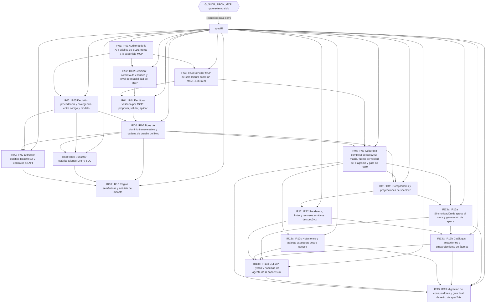

# DAG de specIR

specIR es un paquete periférico construido sobre la API pública de SLDB. Incluye su MCP de modelado semántico y, en una rama posterior, la cobertura completa de la superficie pública de spec2viz: modelos y formatos de spec, compiladores, renderers, linter, recursos, catálogos, notaciones/paletas, CLI, API Python, habilidad de agente y migración de consumidores. El MCP de SLDB para integrar capacidades de pron es trabajo externo propiedad del desk de sldb; specIR no importa pron ni implementa allí.

Los TaskDocs son la fuente canónica de contratos y dependencias. Ejecuta `python desk/drawer/plans/specir/build_plan.py` tras editarlos para refrescar `dag.yaml` y este resumen.
El cierre total también requiere resolver `G_SLDB_PRON_MCP` en el desk de SLDB. Cada tarea conserva sus gates de activación y cierre de DeskOps.

## Grafo

## Nodos y dependencias

| Nodo | TaskDoc | Depende de | Entregables |
|---|---|---|---|
| IR01 | [`desk/tasks/task-ir01-auditoría-de-la-api-pública-de-sldb-frente-a-la-superficie-mcp.md`](../../../tasks/task-ir01-auditoría-de-la-api-pública-de-sldb-frente-a-la-superficie-mcp.md) | — | `docs/auditoria/sldb-api-frente-a-mcp.md` |
| IR02 | [`desk/tasks/task-ir02-decisión-contrato-de-escritura-y-nivel-de-mutabilidad-del-mcp.md`](../../../tasks/task-ir02-decisión-contrato-de-escritura-y-nivel-de-mutabilidad-del-mcp.md) | IR01 | `docs/decisiones/contrato-de-escritura-mcp.md` |
| IR03 | [`desk/tasks/task-ir03-servidor-mcp-de-solo-lectura-sobre-un-store-sldb-real.md`](../../../tasks/task-ir03-servidor-mcp-de-solo-lectura-sobre-un-store-sldb-real.md) | IR01 | `pyproject.toml` `src/specir/__init__.py` `src/specir/mcp/__init__.py` `src/specir/mcp/server.py` `src/specir/mcp/read_tools.py` `src/specir/mcp/addresses.py` `src/specir/mcp/paging.py` `tests/conftest.py` `tests/mcp/test_read_tools.py` `tests/mcp/test_no_writes.py` `tests/test_imports.py` |
| IR04 | [`desk/tasks/task-ir04-escritura-validada-por-mcp-proponer-validar-aplicar.md`](../../../tasks/task-ir04-escritura-validada-por-mcp-proponer-validar-aplicar.md) | IR02, IR03 | `src/specir/mcp/write_tools.py` `src/specir/mcp/changes.py` `src/specir/mcp/mutability.py` `tests/mcp/test_write_tools.py` `tests/mcp/test_dry_run.py` `tests/mcp/test_mutability.py` |
| IR05 | [`desk/tasks/task-ir05-decisión-procedencia-y-divergencia-entre-código-y-modelo.md`](../../../tasks/task-ir05-decisión-procedencia-y-divergencia-entre-código-y-modelo.md) | IR01 | `docs/decisiones/procedencia-y-divergencia.md` |
| IR06 | [`desk/tasks/task-ir06-tipos-de-dominio-transversales-y-cadena-de-prueba-del-blog.md`](../../../tasks/task-ir06-tipos-de-dominio-transversales-y-cadena-de-prueba-del-blog.md) | IR04, IR05 | `src/specir/models/__init__.py` `src/specir/models/domain.py` `src/specir/data/relation_types.yaml` `src/specir/data/rules.yaml` `src/specir/install.py` `tests/models/test_domain_models.py` `tests/models/test_blog_chain.py` `tests/fixtures/blog_chain.yaml` |
| IR07 | [`desk/tasks/task-ir07-cobertura-completa-de-spec2viz-matriz-fuente-de-verdad-del-diagrama-y-gate-de-retiro.md`](../../../tasks/task-ir07-cobertura-completa-de-spec2viz-matriz-fuente-de-verdad-del-diagrama-y-gate-de-retiro.md) | IR03, IR06 | `docs/spec2viz/matriz-de-cobertura.md` `docs/spec2viz/gate-de-retiro.md` `docs/decisiones/fuente-de-verdad-del-diagrama.md` |
| IR08 | [`desk/tasks/task-ir08-extractor-estático-django-drf-y-sql.md`](../../../tasks/task-ir08-extractor-estático-django-drf-y-sql.md) | IR05, IR06 | `src/specir/extract/__init__.py` `src/specir/extract/provenance.py` `src/specir/extract/django_drf.py` `src/specir/extract/sql_schema.py` `tests/extract/test_django_drf.py` `tests/extract/test_sql_schema.py` `tests/extract/test_idempotencia.py` `tests/fixtures/blog_backend/manage.py` |
| IR09 | [`desk/tasks/task-ir09-extractor-estático-react-tsx-y-contratos-de-api.md`](../../../tasks/task-ir09-extractor-estático-react-tsx-y-contratos-de-api.md) | IR05, IR06 | `src/specir/extract/react_tsx.py` `src/specir/extract/api_contracts.py` `tests/extract/test_react_tsx.py` `tests/extract/test_api_contracts.py` `tests/fixtures/blog_frontend/package.json` |
| IR10 | [`desk/tasks/task-ir10-reglas-semánticas-y-análisis-de-impacto.md`](../../../tasks/task-ir10-reglas-semánticas-y-análisis-de-impacto.md) | IR06, IR08, IR09 | `src/specir/data/layer_rules.yaml` `src/specir/impact.py` `src/specir/mcp/impact_tools.py` `tests/rules/test_layer_rules.py` `tests/test_impact.py` |
| IR11 | [`desk/tasks/task-ir11-compiladores-y-proyecciones-de-spec2viz.md`](../../../tasks/task-ir11-compiladores-y-proyecciones-de-spec2viz.md) | IR07, IR06 | `src/specir/visual/__init__.py` `src/specir/visual/spec_models.py` `src/specir/visual/loader.py` `src/specir/visual/validator.py` `src/specir/visual/ir.py` `src/specir/visual/compilers.py` `src/specir/visual/projections.py` `tests/visual/test_spec_models.py` `tests/visual/test_compilers.py` `tests/visual/test_projections.py` |
| IR12 | [`desk/tasks/task-ir12-renderers-linter-y-recursos-estáticos-de-spec2viz.md`](../../../tasks/task-ir12-renderers-linter-y-recursos-estáticos-de-spec2viz.md) | IR11 | `src/specir/visual/renderers/__init__.py` `src/specir/visual/renderers/mermaid.py` `src/specir/visual/renderers/plantuml.py` `src/specir/visual/renderers/d2.py` `src/specir/visual/renderers/vega.py` `src/specir/visual/renderers/bpmn.py` `src/specir/visual/renderers/tree.py` `src/specir/visual/renderers/graph_html.py` `src/specir/visual/renderers/antonia_html.py` `src/specir/visual/renderers/json_out.py` `src/specir/visual/lint_mermaid.py` `src/specir/visual/schema.py` `src/specir/visual/templates/default.html` `tests/visual/test_renderers.py` `tests/visual/test_lint_mermaid.py` `tests/visual/test_schema.py` `tests/visual/test_resources.py` |
| IR13 | [`desk/tasks/task-ir13-sync-generación-catálogos-consumidores-y-retiro-de-spec2viz.md`](../../../tasks/task-ir13-sync-generación-catálogos-consumidores-y-retiro-de-spec2viz.md) | IR13a, IR13b, IR13c, IR13d, IR07 | `src/specir/visual/retirement.py` `src/specir/cli.py` `tests/visual/test_retirement_gate.py` `docs/spec2viz/acta-de-retiro.md` `docs/spec2viz/matriz-de-cobertura.md` |
| IR13a | [`desk/tasks/task-ir13a-sincronización-de-specs-al-store-y-generación-de-specs.md`](../../../tasks/task-ir13a-sincronización-de-specs-al-store-y-generación-de-specs.md) | IR07, IR11 | `src/specir/visual/sync.py` `src/specir/visual/graph_import.py` `src/specir/visual/generate_python.py` `tests/visual/test_sync.py` `tests/visual/test_graph_import.py` `tests/visual/test_generate_python.py` |
| IR13b | [`desk/tasks/task-ir13b-catálogos-anotaciones-y-emparejamiento-de-átomos.md`](../../../tasks/task-ir13b-catálogos-anotaciones-y-emparejamiento-de-átomos.md) | IR13a, IR12 | `src/specir/visual/catalog.py` `src/specir/visual/catalog_serve.py` `src/specir/visual/atoms.py` `tests/visual/test_catalog.py` `tests/visual/test_catalog_serve.py` `tests/visual/test_atoms_matching.py` |
| IR13c | [`desk/tasks/task-ir13c-notaciones-y-paletas-expuestas-desde-specir.md`](../../../tasks/task-ir13c-notaciones-y-paletas-expuestas-desde-specir.md) | IR07 | `src/specir/visual/notations.py` `tests/visual/test_notations.py` `tests/visual/test_palettes.py` |
| IR13d | [`desk/tasks/task-ir13d-cli-api-python-y-habilidad-de-agente-de-la-capa-visual.md`](../../../tasks/task-ir13d-cli-api-python-y-habilidad-de-agente-de-la-capa-visual.md) | IR13a, IR13b, IR13c, IR12 | `src/specir/cli.py` `src/specir/visual/__init__.py` `skills/use-specir/SKILL.md` `docs/spec2viz/correspondencia-cli.md` `tests/visual/test_cli.py` `tests/visual/test_api.py` `tests/visual/test_packaging.py` |

## Gate entre repositorios

`G_SLDB_PRON_MCP` representa el trabajo de SLDB para integrar y exponer las capacidades de pron mediante la API pública/MCP de SLDB. IR01 registra el contrato faltante y prepara el handoff al desk propietario. specIR no importa pron ni implementa cambios de sldb. El gate condiciona el cierre del plan, sin bloquear tareas locales que puedan avanzar con la API actual.

## Cierre del plan

El plan está completo cuando todos los TaskDocs hijos están cerrados con su evidencia/closeout de DeskOps, IR13 demuestra cobertura y migración de consumidores antes de proponer retirar spec2viz, y `G_SLDB_PRON_MCP` tiene la evidencia declarada en `dag.yaml`. No se requiere un artefacto agregado aparte de los recibos de cierre y el acta IR13.
