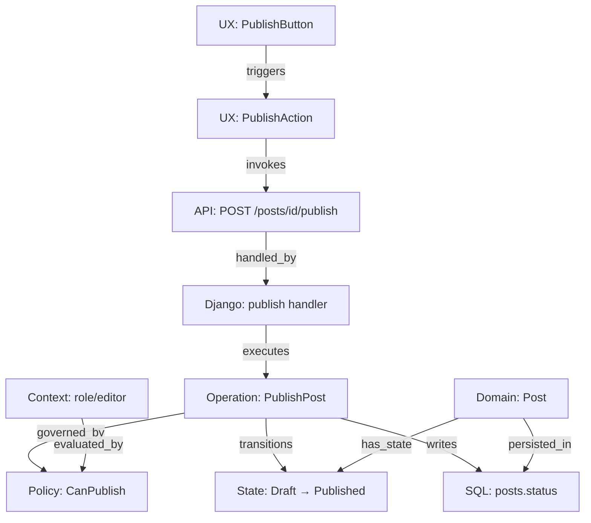
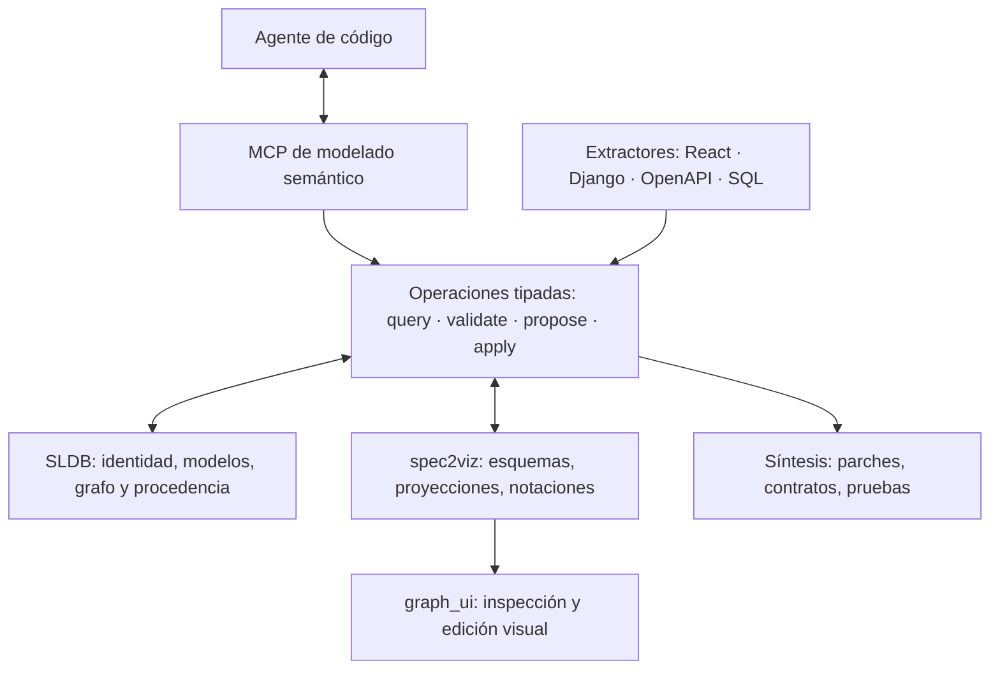

# Fundamentos de una infraestructura de modelado semántico para agentes de código

**Estado:** documento conceptual y arquitectónico · **Fecha:** 11 de noviembre de 2026

## 1. Motivación

Los agentes de código pueden generar componentes React, endpoints Django o modelos SQL, pero suelen perder coherencia cuando una modificación atraviesa varias capas. El problema original surge al diseñar interfaces complejas mediante *vibecoding*: las interacciones, estados, datos, permisos y operaciones de una aplicación están dispersos entre archivos y tecnologías, y no existe una representación común que permita razonarlos conjuntamente.

La propuesta no consiste en generar mejores pantallas a partir de prompts. Consiste en proporcionar a los agentes un **modelo semántico tipado, inspeccionable y modificable del sistema completo**. Una interfaz es una proyección de ese sistema; una API, un diagrama UML y una vista de base de datos son otras representaciones o interfaces de partes de él.

El consumidor principal de esta infraestructura es un **agente a través de MCP** (*Model Context Protocol*). La edición gráfica es complementaria.

## 2. Hipótesis central

**Contrato base:** todo diagrama es una instancia o proyección de un grafo semántico tipado. Sus elementos representan objetos semánticos identificables; las relaciones entre objetos pueden cruzar esquemas de diagramas y límites de implementación.

El modelo debe conservar la distinción entre:

1. **Entidad semántica:** lo que existe en el dominio o sistema (`Post`, `PublishPost`, `POST /posts/{id}/publish`).
2. **Aparición:** presencia de esa entidad en una vista o diagrama determinado.
3. **Proyección:** criterio que selecciona y organiza elementos y relaciones del grafo para una finalidad determinada.
4. **Notación:** reglas para representarlos visualmente, sin redefinir su identidad ni su significado.

En consecuencia, dos diagramas pueden representar el mismo objeto sin duplicarlo semánticamente. Un diagrama de estados y uno de componentes no necesitan hablar directamente entre sí: sus elementos están conectados mediante el grafo.

## 3. Dimensiones semánticas del sistema

Las siguientes dimensiones describen aspectos complementarios, **no silos ni bases de datos separadas**:

| Dimensión | Pregunta | Ejemplos |
|---|---|---|
| Dominio | ¿Qué cosas y relaciones existen? | `Post`, `Author`, `Category`, autoría |
| Datos | ¿Qué estructuras, valores y conjuntos de datos existen? | tablas, columnas, filas, cardinalidades, distribuciones |
| Operaciones y transformaciones | ¿Qué puede hacer o calcular el sistema? | `publish_post`, consultas, `markdown_to_html`, efectos |
| Estados | ¿En qué situación se encuentran las cosas y qué transiciones admiten? | borrador, publicado, guardando, error |
| Contexto | ¿Quién actúa y bajo qué condiciones? | roles, permisos, organización, sesión, entorno |

La **proyección** no es una sexta dimensión del negocio: es el mecanismo de selección y representación de estas dimensiones. UX es un tipo particular de proyección interactiva, pero no el único.

Es importante distinguir *operación*, *transformación*, *efecto* y *evento*. Una operación declara una capacidad o comportamiento; una transformación produce un resultado a partir de entradas; un efecto modifica el entorno o el estado persistente; un evento registra que algo ocurrió. Estas distinciones hacen posible analizar dependencias y cambios.

## 4. Ejemplo conductor: editor de blog

Consideremos una aplicación tipo WordPress, implementada con React, Django REST Framework y PostgreSQL. El usuario edita un post, lo guarda y eventualmente lo publica.



**El botón no es el centro del modelo.** `PublishPost` puede invocarse desde una UI, una CLI, una tarea programada o un agente. Una nueva capacidad en Django puede sugerir una interacción nueva, pero no determina automáticamente si debe ser botón, menú, diálogo o flujo de varias pantallas.

La UX depende de (a) operaciones existentes, (b) estados, (c) contexto y políticas, y también (d) datos reales: un blog sin posts requiere un estado vacío; uno con miles de registros requiere búsqueda, filtros y paginación. La forma de la proyección puede cambiar aunque persistan las mismas entidades de dominio.

Al inspeccionar una aplicación existente, el agente debería poder reconstruir conexiones como las del diagrama y detectar brechas: una acción sin endpoint, un campo UX ausente del serializer, una regla del backend no representada en la interfaz o una consulta que no escala para el volumen de datos.

## 5. Fundamento en estándares OMG

No proponemos implementar todo UML ni migrar a Eclipse. Adoptamos conceptos de la tradición de **Model-Driven Engineering** del *Object Management Group* (OMG) para que el sistema tenga fundamentos explícitos, validables e interoperables.

| Estándar / familia | Aporte al proyecto | Límite de adopción previsto |
|---|---|---|
| **MOF / EMOF** | Definición de metamodelos, tipos, instancias e identidad | Inspirar contratos Pydantic; no replicar todo el runtime |
| **UML** | Clases, asociaciones, operaciones, actividades, estados y comportamientos | Subconjuntos útiles y mapeos explícitos |
| **IFML** | Semántica de vistas, eventos y flujos de interacción | Vocabulario para el esquema UX, no editor obligatorio |
| **OCL** | Invariantes, precondiciones y restricciones | Validación semántica equivalente o interoperable |
| **QVT** | Transformaciones modelo-a-modelo | Inspirar contratos declarativos de transformación |
| **MOFM2T** | Transformación de modelo a texto/código | Inspirar generadores auditables |
| **UMLDI / DI** | Diferenciar el modelo representado de su aparición gráfica | Mantener separada semántica y layout |
| **XMI / Ecore** | Intercambio y compatibilidad entre herramientas | Adaptadores selectivos, no formato canónico obligatorio |

La correspondencia no implica compatibilidad OMG automática: solo se podrá afirmar conformidad cuando existan transformaciones probadas y validaciones contra las especificaciones correspondientes.

**Referencias oficiales:** [MOF](https://www.omg.org/spec/MOF/), [UML](https://www.omg.org/spec/UML/), [IFML](https://www.omg.org/spec/IFML/), [OCL](https://www.omg.org/spec/OCL/), [QVT](https://www.omg.org/spec/QVT/), [XMI](https://www.omg.org/spec/XMI/).

### Implementaciones de referencia

- **EMF/Ecore**: metamodelos y objetos tipados.
- **Sirius**: viewpoints declarativos y diferentes representaciones de un modelo común.
- **GLSP**: edición de diagramas con un modelo fuente desacoplado de la representación y operaciones estructuradas.
- **EMF Model Server**: contratos de acceso y modificación de modelos.

Se estudian para **copiar principios de modelo, API y —solo donde compense— UI**, no para adoptar íntegramente sus stacks Java o TypeScript.

## 6. Arquitectura sobre los proyectos existentes

El proyecto parte de infraestructura ya construida:

- **SLDB:** documentos direccionables, modelos Pydantic, stores enlazados, relaciones tipadas, grafo y extracción de estructuras desde código.
- **spec2viz:** especificaciones de diagramas, validación, IR de renderizado, sincronización con SLDB, notaciones declarativas y resolución de vistas.
- **graph_ui:** exploración y edición visual sobre los stores, incluyendo vistas y notaciones de spec2viz.



**Cuidado arquitectónico:** la documentación de los repositorios existentes debe auditarse antes de establecer nuevas fuentes de verdad. Si un contrato canónico ya reside en `specYaml` o en otro componente del ecosistema, SLDB debe integrarse con él y no competir por la autoridad semántica. La figura ilustra responsabilidades funcionales, no una decisión irreversible de propiedad de datos.

El núcleo de operaciones debe ser reutilizable por MCP, API y editor. No se implementará una semántica independiente dentro de cada interfaz.

## 7. MCP como producto prioritario

El problema de *vibecoding* se resuelve si un agente puede operar sobre el significado del sistema y no solo sobre archivos. El primer producto es por eso un **servidor MCP que expone capacidades semánticas tipadas**.

Herramientas iniciales, con nombres ilustrativos:

```text
models.list / models.describe
entities.inspect / graph.query / graph.trace
projections.list / projections.resolve
changes.propose / changes.validate / changes.apply
```

Capacidades posteriores:

```text
source.extract / ux.deconstruct
impact.analyze / inconsistencies.detect
transform.execute / synthesis.propose_patch
```

Principios de seguridad y consistencia:

- Consultas sin efectos laterales.
- Separación entre proponer, validar y aplicar una modificación.
- Identificación de la procedencia de cada nodo o relación: observado, inferido o validado.
- Control de versión y precondiciones para evitar aplicar cambios sobre estados desactualizados.
- Permisos reales aplicados en el backend, nunca delegados exclusivamente a la UX o al agente.
- Validación de conformidad con los metamodelos y de invariantes entre capas.

Una inferencia del LLM **no debe convertirse silenciosamente en un hecho validado**.

## 8. Ingeniería inversa y síntesis

El flujo buscado es bidireccional, pero no equivale a una compilación perfectamente reversible de cualquier aplicación.

**Deconstrucción:** inspeccionar código, AST, rutas, contratos HTTP, modelos SQL, estados de UI y observaciones de ejecución; construir nodos y relaciones con evidencia, señalar ambigüedades y solicitar validación donde corresponda.

**Síntesis:** seleccionar una operación o capacidad, recorrer sus dependencias, proponer cambios en UI/API/backend/datos, generar parches y pruebas, y comprobar su coherencia con el grafo. La propuesta y el código generado se mantienen trazables a las entidades semánticas que los motivaron.

No todo comportamiento puede inferirse desde una captura de pantalla; no toda regla puede reconstruirse desde un endpoint; no todo requisito de UX se desprende automáticamente del modelo de datos. El sistema debe conservar lo que desconoce.

## 9. Criterios de éxito del primer experimento

Se usará un blog de juguete con React, Django REST Framework y PostgreSQL. El experimento se considera satisfactorio cuando el agente puede:

1. Descubrir modelos, relaciones y operaciones del sistema mediante MCP.
2. Reconstruir `PublishButton → PublishAction → endpoint → handler → operación → tabla`.
3. Identificar que un post puede estar en borrador o publicado, y que publicar depende de una política.
4. Detectar que un cambio de schema, serializer o regla afecta a elementos de UX concretos.
5. Proponer una modificación sin alterar código todavía; validarla y luego aplicarla con trazabilidad.
6. Verificar el resultado con pruebas y representar los elementos relevantes mediante spec2viz.

### Lo que no buscamos en el primer MVP

No buscamos un clon de EMF/Sirius, implementación completa de UML, editor gráfico nuevo, generador universal de aplicaciones ni inferencia automática perfecta de las reglas de cualquier sistema.

## 10. Decisión arquitectónica de fondo

**El grafo semántico no es un dibujo de la aplicación: es una representación operable de sus entidades, comportamientos, datos, estados, contextos y relaciones.** Los diagramas y las interfaces son proyecciones; el MCP permite a los agentes consultar y modificar ese modelo; las transformaciones conectan modelo y código.

La prioridad de desarrollo es demostrar primero esa operación semántica con MCP, tomando de OMG los fundamentos de modelado, y usando las herramientas ya construidas en vez de recrearlas.
